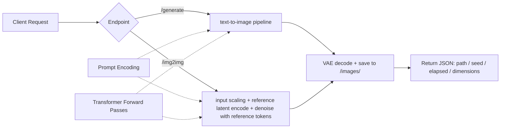

# T.H.E.O. - Thought Holography and Extraction Operator

FastAPI image generation server running in a podman container, optimized for 16 GB VRAM systems (AMD ROCm / NVIDIA CUDA).

## Overview

This service provides AI-powered image generation and editing using **FLUX.2-klein-4B**, a distilled variant of the FLUX.2 model family. The implementation is designed to:

- ✅ Run efficiently on 16 GB VRAM (sequential CPU offload, one component on the GPU at a time)
- ✅ Deliver fast generation (distilled to 4 steps by default)
- ✅ Support both text-to-image (`/generate`) and image-to-image editing (`/img2img`)
- ✅ Produce reproducible results via seed control
- ✅ Integrate with Open-WebUI as its built-in image backend (the `openai` engine, proxied by `jarvis-phil`)

## Features

### Text-to-Image Generation (`POST /generate`)

Generate images from text prompts with customizable dimensions, steps, and seeds.

**Example:**
```bash
curl -X POST http://localhost:8190/generate \
  -H "Content-Type: application/json" \
  -d '{"prompt": "A futuristic cityscape at sunset", "seed": 42}'
```

**Response:**
```json
{"path": "/images/flux_1792160000_42.png", "seed": 42, "elapsed_seconds": 12.3}
```

### Image-to-Image Editing (`POST /img2img`)

Transform existing images with text-guided edits. The input is sent as a base64-encoded image in a JSON body; the output grid is derived from the input (scaled to ~1 MP, aspect preserving, floored to a multiple of 16).

The edit uses the same reference-latent logic as `edit_image.py`: denoising starts from **pure noise**, and the VAE-encoded input image is concatenated as reference tokens onto the denoise sequence, so the reference conditions the transformer's joint self-attention. Edit intensity is controlled by the prompt and step count (there is no `strength` parameter).

**Example:**
```bash
B64=$(base64 -w0 input_photo.jpg)
curl -X POST http://localhost:8190/img2img \
  -H "Content-Type: application/json" \
  -d "{\"prompt\": \"Change background to sunset beach\", \"image_base64\": \"$B64\", \"steps\": 4, \"seed\": 42}"
```

**Response:**
```json
{
  "path": "/images/flux_img2img_1792165496_42.png",
  "seed": 42,
  "elapsed_seconds": 52.4,
  "input_dimensions": {"width": 960, "height": 1280},
  "output_dimensions": {"width": 880, "height": 1168}
}
```

## Open-WebUI Integration

This FLUX service is designed to work with **Open-WebUI v0.12.3** as its **built-in image backend**: the UI's "Image Generation" and "Edit Image" features use the `openai` engine against the `jarvis-phil`'s OpenAI-compatible endpoints (`/v1/images/generations` and `/v1/images/edits` on port 8191). No tool servers, tool attachments, or LLM tool calls are involved — the UI posts the request, the supervisor swaps the GPU (stop LLM → start FLUX), forwards it to FLUX, then restores the LLM, and the UI renders the returned base64 image.

### Quick Setup in Open-WebUI (v0.12.3)

1. **Ensure jarvis-phil is running:**
   ```bash
   systemctl --user start jarvis-phil
   ```

2. **Configure the built-in backends** (Settings gear → **Admin → Interfaces**):
   - **Image Generation** card — Engine: `openai`, Base URL: `http://host.containers.internal:8191/v1`, API key: any non-empty string (e.g. `jarvis`), Model: any value (sent to FLUX but ignored)
   - **Edit Image** card — same Engine / Base URL / API key / Model
   - Save the cards. If `SWAP_API_TOKEN` is set on the supervisor, the API key must equal that token (the backend sends it as `Authorization: Bearer`); with the token unset (the current default), any non-empty key works.

3. **Use it in chat — no tool selection:**
   - Text-to-image: ask the model to "draw / generate / illustrate …" → the UI calls `POST /v1/images/generations`
   - Edit image: attach an image and describe the edit → the UI calls `POST /v1/images/edits`
   - Expect ~50–75 s for a generation and ~70–90 s for an edit, including the ~20 s GPU swap.

## Quick Start

All commands run from the repository root (`jarvis_openwebui/`).

### 1. Build and Start the Container
```bash
podman build -t jarvis-theo theo/
podman compose -f theo/compose.yaml up -d
```

### 2. Wait for the Model to Load
The model loads at container startup and takes ~30–60 seconds:
```bash
# Poll health endpoint until ready
while ! curl http://localhost:8190/health | grep '"status":"ready"'; do
  echo "Waiting for model..."; sleep 5
done

echo "Model is ready!"
curl http://localhost:8190/health
```

### 3. Generate Your First Image
```bash
curl -X POST http://localhost:8190/generate \
  -H "Content-Type: application/json" \
  -d '{
    "prompt": "A serene mountain landscape with a lake reflection",
    "width": 1024,
    "height": 768,
    "steps": 4,
    "seed": 123
  }'
```

The response contains the container path (`/images/flux_<timestamp>_<seed>.png`); the file is written to the host's `generated_images/` directory:
```bash
xdg-open generated_images/flux_*.png  # Linux
```

## API Documentation

- **[QUICKSTART.md](./QUICKSTART.md)** — cURL/Python examples for every endpoint, including the OpenAI-compatible ones

## Endpoint Reference

| Method | Endpoint | Description |
|--------|----------|-------------|
| `GET` | `/health` | Model readiness status (`loading` / `ready`) |
| `GET` | `/info` | Device and VRAM diagnostics |
| `POST` | `/generate` | Text-to-image generation (legacy JSON API) |
| `POST` | `/img2img` | Image-to-image editing (legacy JSON API, reference-latent denoise) |
| `POST` | `/v1/images/generations` | OpenAI-compatible text-to-image (alias: `POST /images/generations`) |
| `POST` | `/v1/images/edits` | OpenAI-compatible image edit, multipart (alias: `POST /images/edits`) |

### `POST /generate` request

| Field | Type | Default | Description |
|-------|------|---------|-------------|
| `prompt` | string | — | Text prompt |
| `width` | int (512–1536) | 1024 | Output width (floored to a multiple of 16) |
| `height` | int (512–1536) | 1024 | Output height (floored to a multiple of 16) |
| `cfg_scale` | float (0–20) | 1.0 | Classifier-free guidance; only >1.0 adds the negative (empty-prompt) pass |
| `steps` | int (1–100) | 4 | Denoising steps |
| `seed` | int | -1 | Seed; -1 = random per request |

### `POST /img2img` request

| Field | Type | Default | Description |
|-------|------|---------|-------------|
| `prompt` | string (1–500) | — | Text prompt describing the desired edit |
| `image_base64` | string | — | Input image as base64-encoded PNG/JPEG |
| `cfg_scale` | float (0–20) | 1.0 | Classifier-free guidance; only >1.0 adds the negative (empty-prompt) pass |
| `steps` | int (1–100) | 4 | Denoising steps |
| `seed` | int | -1 | Seed; -1 = random per request |

Output width/height are derived from the input image; extra request fields (e.g. `width`, `height`, or the old `strength`) are silently ignored, so old clients keep working.

### `POST /v1/images/generations` request

OpenAI Images API shape (JSON body). Stock OpenAI fields (`model`, `background`, `quality`, `style`, `response_format`, …) are accepted and ignored, so the stock Open WebUI client works unmodified.

| Field | Type | Default | Description |
|-------|------|---------|-------------|
| `prompt` | string (min 1) | — | Text prompt |
| `model` | string | — | Accepted and ignored |
| `n` | int (1–4) | 1 | Images to generate; seeds run `seed`, `seed+1`, … (mod 2³²) |
| `size` | string `WxH` | — (→ `1024x1024`) | 256–2048 per side, e.g. `"1024x768"`; anything else → 422 |
| `steps` | int (1–50) | 4 | Denoising steps |
| `cfg_scale` | float (0–20) | 1.0 | Classifier-free guidance; only >1.0 adds the negative (empty-prompt) pass |
| `seed` | int (≥ −1) | -1 | Seed; -1 = random (ms timestamp mod 2³²) |

**Response** (OpenAI Images API shape):

```json
{
  "created": 1760600000,
  "data": [
    {
      "b64_json": "<base64-encoded PNG>",
      "url": "/images/flux_1760600000_42.png",
      "revised_prompt": "A futuristic cityscape at sunset",
      "seed": 42
    }
  ]
}
```

`url` is cosmetic — the PNG is also written to `generated_images/` (container path `/images`). Open WebUI's backend consumes `b64_json`.

### `POST /v1/images/edits` request

OpenAI Images API shape (multipart/form-data body).

| Field | Type | Default | Description |
|-------|------|---------|-------------|
| `image` | file (PNG/JPEG) | — | Input image; `image[]` is also accepted — the first image wins |
| `prompt` | string | — | Text prompt describing the desired edit |
| `n` | int (1–4) | 1 | Edits to generate; seeds run `seed`, `seed+1`, … (mod 2³²) |
| `seed` | int (≥ −1) | -1 | Seed; -1 = random (ms timestamp mod 2³²) |

Other form fields (`size`, `model`, `steps`, `cfg_scale`, …) are accepted and ignored: edits run at the FLUX defaults (4 steps, `cfg_scale` 1.0) and the output size is derived from the input image (~1 MP, floored to a multiple of 16). Response shape is the same as `/v1/images/generations`; PNGs are named `flux_img2img_<ts>_<seed>.png`.

## Configuration

Set via environment variables in `theo/compose.yaml`:

```yaml
environment:
  IMG_MODEL_PATH: /models/img/FLUX.2-klein-4B   # Model checkpoint directory (volume-mounted from models/theo)
  FLUX_OUTPUT_DIR: /images                       # Where generated PNGs are written (host: generated_images/)
  # AMD ROCm (RX 6950 XT, gfx1030)
  HSA_OVERRIDE_GFX_VERSION: "10.3.0"
  MIOPEN_FIND_MODE: "2"                          # FAST find mode; no per-process kernel search
  PYTORCH_CUDA_ALLOC_CONF: "expandable_segments:True"   # Keeps allocator segments expandable; avoids the flaky VRAM OOM on this borderline 16 GB card
```

## Technical Details

### Model Specifications
- **Model:** FLUX.2-klein-4B (distilled variant, ~4B params) + Qwen3-4B text encoder
- **Pipeline:** `Flux2KleinPipeline` from Hugging Face diffusers
- **Precision:** bfloat16 (BF16)
- **Inference Steps:** Distilled for 4 steps (configurable 1–100 on both endpoints)
- **Guidance:** The transformer runs with `guidance=None` (the distilled checkpoint ignores `guidance_scale`); both endpoints expose `cfg_scale` (default 1.0, i.e. CFG off)

### Memory Optimization Strategy
The model components (text encoder, transformer, VAE) total ~17 GB, which exceeds 16 GB VRAM for inference with activations, so the pipeline runs with **sequential CPU offload** — one component on the GPU at a time:

- **Sequential CPU offload:** `enable_sequential_cpu_offload()` moves components between CPU and GPU per phase; peak VRAM ~7–10 GB
- **VAE tiling & slicing:** Reduce decode memory peaks
- **Inference mode:** Denoising runs under `torch.inference_mode` on both endpoints
- **Per-request cleanup:** CUDA synchronize + `gc.collect()` + `empty_cache()` after every request

> ⚠️ **Shared GPU:** This container shares the 16 GB GPU with the LLM container (ARC) — one model resident at a time. The `jarvis-phil` switches containers automatically; for manual use, stop the LLM container before using FLUX, or requests will fail with a 500 (CUDA out of memory).

### Performance Benchmarks

Measured on an RX 6950 XT (16 GB, ROCm, sequential CPU offload):

| Operation | Steps | Input → Output | Time |
|-----------|-------|----------------|------|
| Image-to-Image | 4 | 960×1280 → 880×1168 | ~52 s |
| Text-to-Image | 4 | — → 1024×1024 | ~25 s |

Denoising time scales roughly linearly with step count. Image-to-Image runs about 2× slower than text-to-image at comparable output resolution (~1 MP) because it also VAE-encodes the input image and appends its reference latents to the attention sequence.

### Image-to-Image Edit Pipeline

1. Decode base64 → PIL RGB; record original dimensions.
2. Scale to ~1 MP total pixels preserving aspect ratio (NEAREST); floor both dimensions to a multiple of 16 (`vae_scale_factor × 2`). Inputs so small that a dimension falls below 16 after scaling are rejected (HTTP 400).
3. Encode the prompt with the Qwen3 chat template (generation prompt, thinking disabled), fitting the text sequence to the prompt length (cap 512 tokens).
4. Prepare pure-Gaussian-noise denoise latents on the GPU (seeded generator).
5. VAE-encode the scaled input image (batch-norm normalized) → reference latents + latent position IDs.
6. Denoise loop: reference latents are concatenated onto the denoise sequence so the transformer's joint self-attention conditions on the input; flow-matching scheduler with empirical-μ timestep schedule; when `cfg_scale > 1.0`, an additional empty-prompt pass is run per step.
7. Unpack the latents, apply the VAE's batch-norm statistics, unpatchify, VAE-decode, and postprocess to PIL.
8. Save the PNG to `/images` (host: `generated_images/`) as `flux_img2img_<timestamp>_<seed>.png`.

## Troubleshooting

### Model not loading (status="loading")
The model loads at container startup and takes ~30–60 seconds. Poll `/health`:
```bash
watch -n 2 'curl http://localhost:8190/health'
```

### 500 CUDA out-of-memory
The GPU is shared with the LLM container. One model can be resident at a time — let the `jarvis-phil` handle switching, or stop the LLM container (`podman stop <llm-container>`) before using FLUX.

### 400 "input image too small"
Only extreme aspect ratios or tiny inputs fail the ~1 MP scaling. Use a larger input image.

### Slow inference times
Check device/VRAM state with `/info`:
```bash
curl http://localhost:8190/info | jq .
```
Restart the container if memory appears fragmented; the MIOpen kernel cache (`.miopen/`) persists across restarts, so restarts get faster, not slower.

## Development & Extensibility

### Adding New Features
When adding new endpoints:
1. Follow the existing error handling pattern (check `_model_ready` first)
2. Use `pipeline.encode_prompt(...)` with the chat-template-derived `max_sequence_length` for text encoding
3. Drive the pipeline components manually (encode prompt → prepare latents → scheduler loop → VAE decode) for full control over sampling
4. Save output with the timestamp + seed naming convention (`flux_<ts>_<seed>.png` / `flux_img2img_<ts>_<seed>.png`)

### Testing Changes
```bash
# Rebuild and restart to load changes (from repo root)
podman build -t jarvis-theo theo/
podman compose -f theo/compose.yaml up -d

# End-to-end text-to-image test (/generate + /v1/images/generations, positive + 422 checks)
python3 theo/test_txt2img.py

# End-to-end image-edit test (/img2img + /v1/images/edits, positive + 422 checks)
python3 theo/test_img2img.py

# Check logs for errors
podman logs --tail 50 jarvis-theo
```

### Container Management

**Start:**
```bash
podman compose -f theo/compose.yaml up -d
```

**Stop:**
```bash
podman compose -f theo/compose.yaml down
```

**View Logs:**
```bash
podman logs -f jarvis-theo
```

**Rebuild after code changes:**
```bash
podman build -t jarvix-theo theo/
podman compose -f theo/compose.yaml up -d
```

## Architecture Overview



## References

- [FLUX.2-klein Official Docs](https://huggingface.co/docs/diffusers/en/api/pipelines/flux2)
- [Fal.ai FLUX.2 User Guide](https://fal.ai/learn/devs/flux-2-klein-user-guide)
- Hugging Face Diffusers: `Flux2KleinPipeline` API

## License & Credits

This service uses the FLUX model from Black Forest Labs, distributed under their terms of use. The implementation is optimized for local deployment within the jarvis_openwebui project infrastructure.

---

**Version:** 1.1.0  
**Last Updated:** 2026-10-17  
**Maintainer:** Michael (jarvis_openwebui team)
